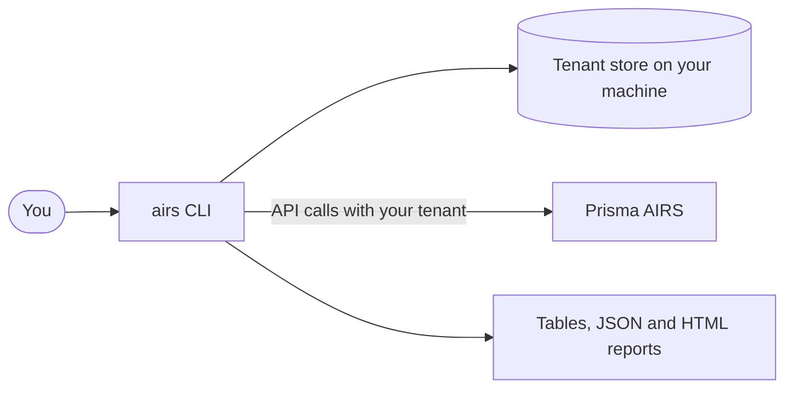
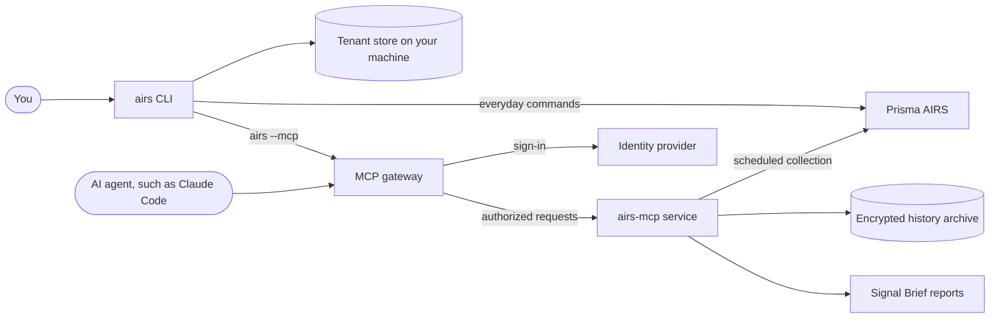

# airs-cli

[](https://cdot65.github.io/prisma-airs-cli/)
[](https://crates.io/crates/airs-cli)
[](https://crates.io/crates/airs-runtime-core)
[](https://crates.io/crates/airs-mcp-client)

`airs` is one native command line to manage, scan and report on everything in Prisma AIRS.
Version 9.1.0 covers runtime security, AI red teaming, model security, DLP, the AI gateway and supply chain, and an [optional MCP service](https://cdot65.github.io/prisma-airs-cli/mcp-server/introduction) adds retained history, scheduled collection and reports for you and your AI agents.

Release availability is recorded on [Forgejo](https://git.cdot.io/cdot/prisma-airs-cli/releases)
and in the [release notes](docs/RELEASE-NOTES/9.1.0.md).

## Install

Pick one, then see the [full install guide](https://cdot65.github.io/prisma-airs-cli/getting-started/install) for other channels.

**[Cargo](https://crates.io/crates/airs-cli)** (Rust 1.89 or newer):

```sh
cargo install --locked airs-cli
```

**[npm](https://www.npmjs.com/package/@cdot65/prisma-airs-cli)** (prebuilt binaries for Apple Silicon macOS and Linux x64 and arm64; Node 18 or newer):

```sh
npm install -g @cdot65/prisma-airs-cli
```

Then check it and register a tenant:

```sh
airs --version     # prints the version, e.g. 9.1.0
airs tenant create <name>
airs doctor
```

## How it works

With just the CLI:



With the optional MCP service added:


