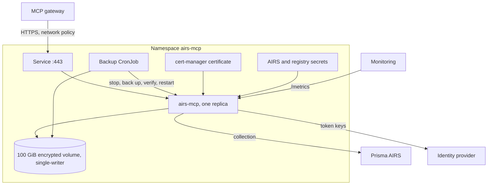
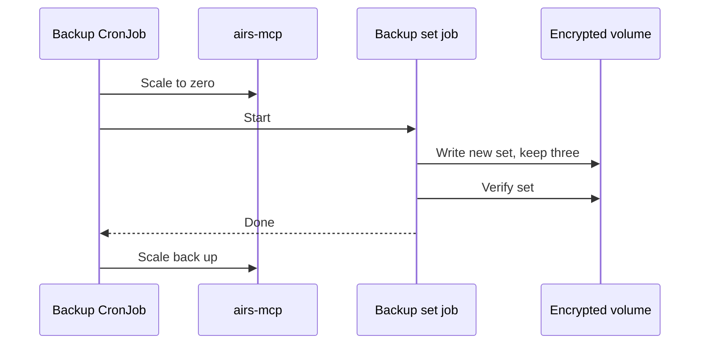

# Deploying the MCP server

This page is the overview. The complete procedure, including every check, is in the
[deployment runbook](https://github.com/cdot65/prisma-airs-cli/blob/main/docs/RUNTIME_MCP_DEPLOYMENT_RUNBOOK.md),
and the manifests are in
[`deploy/airs-mcp`](https://github.com/cdot65/prisma-airs-cli/tree/main/deploy/airs-mcp).

## What gets deployed



## Prerequisites

| You need | For |
|---|---|
| Kubernetes with NetworkPolicy support | Running the service with its network rules |
| An encrypted StorageClass with `ReadWriteOncePod` | The archive |
| cert-manager | The service's TLS certificate |
| A container registry | The image, pinned by digest |
| An MCP gateway that signs an identity assertion | Sign-in and routing |
| An OAuth identity provider | Tokens and role scopes |
| A Prisma AIRS service account and scanner key | Collection |
| A GitOps controller or `kubectl` | Applying the manifests |

The service is one replica by design, because a single writer owns the archive. Rollouts use
`Recreate`, so upgrades cause a brief outage.

## Deployment steps


### 1. Configure

Replace every placeholder in `deploy/airs-mcp/airs-mcp.toml`: your tenant, identity provider, gateway
assertion, grants and scanner. Keep the paths, listeners and bounds. Then validate it:

```sh
cargo test -p airs-mcp --test deploy_manifests
```

### 2. Build and pin the image

```sh
docker build --platform linux/amd64 -f deploy/airs-mcp/Dockerfile -t <registry>/airs-mcp:<version> .
docker push <registry>/airs-mcp:<version>
```

Put the pushed digest in `deploy/airs-mcp/kustomization.yaml`, and pin the backup job's `kubectl`
image the same way. Confirm that everything is pinned:

```sh
AIRS_MCP_DEPLOY_DIR=deploy/airs-mcp AIRS_MCP_REQUIRE_DEPLOYABLE=1 \
  cargo test -p airs-mcp --test deploy_manifests
```

### 3. Storage and secrets

Create the encrypted StorageClass, the AIRS credentials secret (`mgmt-client-id`,
`mgmt-client-secret`, `scanner-monitor`), the TLS certificate and the registry pull secret. Do not
store real data until the storage and sign-in checks pass.

### 4. Deploy

```sh
kubectl apply -k deploy/airs-mcp
```

If a GitOps controller self-heals the Deployment, make it ignore replica changes, because the backup
job scales the service to zero while it runs. In Argo CD, use `ignoreDifferences` on `/spec/replicas`
with `RespectIgnoreDifferences=true`.

Supply your control-plane endpoints to the `airs-mcp-backup-to-apiserver` network policy. Then check:

```sh
kubectl -n airs-mcp port-forward deploy/airs-mcp 8081:8081
curl localhost:8081/livez     # ok
curl localhost:8081/readyz    # ready
```

### 5. Bind the gateway

The gateway must be the only route to the service. Use a dedicated, confidential OAuth client, and
confirm that no other gateway integration targets the backend URL.

### 6. Prove sign-in

Follow [Getting started](./getting-started.md), then call `service_info` and `history_status` from
an AI agent.

### 7. Backup and restore

The daily job takes the service down briefly and writes a verified set:



A retained volume is not a backup, so also copy the volume off-site with your storage's backup
feature. Rehearse a restore in an isolated namespace; the runbook has the steps.

## Operating it

| Task | How |
|---|---|
| Health | `/livez`, `/readyz` and `/metrics` on port 8081 |
| Capacity alerts | `airs_mcp_data_volume_free_bytes` against `airs_mcp_data_volume_size_bytes`, at 70% and 85% used |
| Upgrade | Build, set the new digest and apply |
| Roll back | Set the previous digest and apply |
| Corrupt archive | `airs runtime history recover --mcp <name>`; do not delete the volume |
