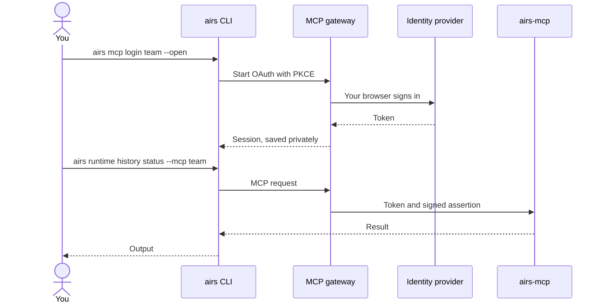
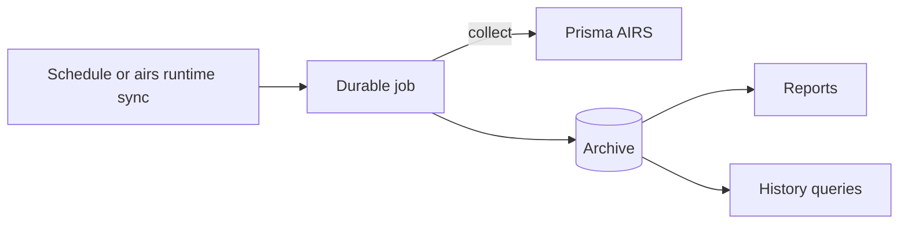

# Getting started with the MCP server

This page connects you to a service that is already running. To run one, see
[Deployment](./deployment.md).

## What you need

- `airs` 8.2 or newer, with a tenant registered ([Install](../getting-started/install.md)).
- From whoever runs the service: the gateway URL, OAuth client ID, service tenant, expected TSG and
  the approved origins.
- A role on the service: Reader is enough to explore.

## How sign-in works

You sign in once in a browser. After that, commands use the saved session and never prompt.



## 1. Add a connection

A connection is saved in your tenant file and holds no secret.

```bash
airs mcp connections set team \
  --url https://mcp.example.com/ws-example/airs/mcp \
  --client-id 00000000-0000-4000-8000-000000000001 \
  --service-tenant airs-tsg-1234567890 --expected-tsg 1234567890 \
  --approved-origin https://mcp.example.com --approved-origin https://login.example.com
```

## 2. Sign in

```bash
airs mcp login team --open
airs mcp status team
```

If your gateway registered an exact loopback redirect, add the port it expects, such as
`--port 53682`.

## 3. Check the service

```bash
airs runtime history status --mcp team     # archive, last collection, gaps
airs runtime history coverage --mcp team   # what is covered in the last 24 hours
```

## 4. Build up history

An Operator can start a collection and put it on a schedule:

```bash
airs runtime sync --mcp team
airs runtime schedules set --mcp team --kind collection --enabled true \
  --effective-at 2026-01-01T00:00:00Z --interval-minutes 60
airs runtime jobs list --mcp team
```



Jobs live on the service, so pressing Ctrl-C only stops the CLI from waiting.

## 5. Get a report

The service renders reports from its archive, without calling Prisma AIRS:

```bash
airs runtime report --mcp team --interval 7 --unit days --bundle-dir ./signal-brief
airs runtime history reports --mcp team
```

## 6. Keep what your scans return

Add `--record-history` to retain results from a scan. It needs a named scanner, and a failure to
record only warns.

```bash
airs runtime scan --scanner prod --record-history team ...
airs runtime receipts upload --mcp team --from-bulk-state ./job.bulk-scan.json
```

## Connect an AI agent

Add the gateway's MCP URL to your agent. In Claude Code:

```bash
claude mcp add --transport http airs https://mcp.example.com/ws-example/airs/mcp
```

Then authenticate with `/mcp` and ask a question such as "What does our scan coverage look like
this week?"

| Tool | Answers |
|---|---|
| `service_info` | Version, health and your access |
| `history_status` | Archive state, last collection, gaps |
| `history_coverage` | Coverage for a time range |
| `history_query` | Bounded summaries, never payloads |
| `reports_list`, `reports_get`, `artifacts_read` | Reports and their text |
| `jobs_list`, `jobs_get`, `schedules_list` | Job and schedule state |

An agent sees only the tools its grant allows.

## Troubleshooting

| You see | Do this |
|---|---|
| `authentication required` | Run `airs mcp login <name>` |
| `Invalid redirect_uri` | Sign in with the `--port` your gateway registered |
| `forbidden` | Ask for a role or tool grant |
| A usage error on a service command | Pass `--mcp <name>`; there is no fallback to live collection |

See the [`airs mcp` command guide](../commands/mcp.md) for everything else.
