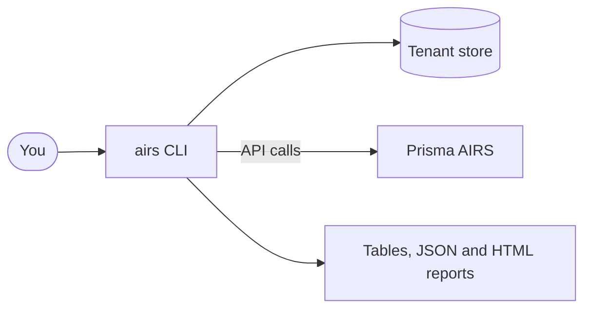
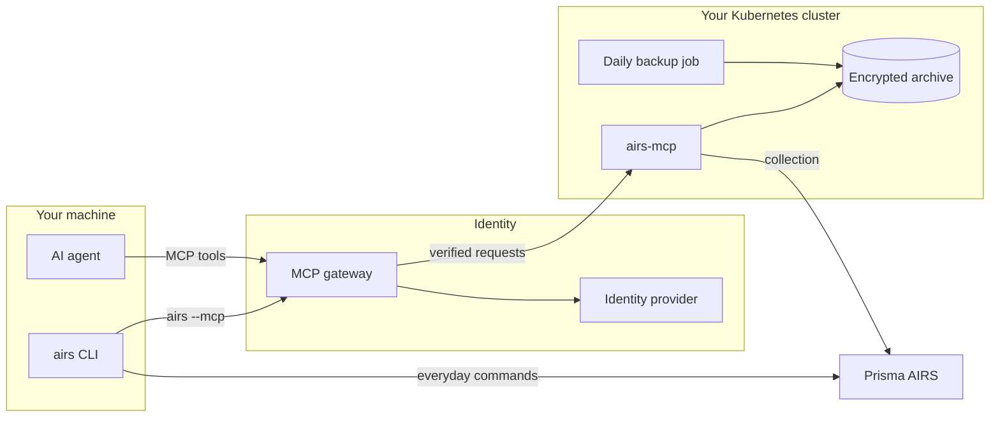
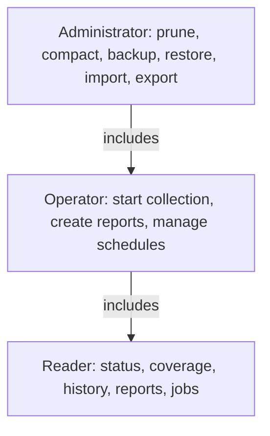

# MCP Server

`airs-mcp` is an optional service that remembers what the CLI cannot. It collects your Prisma AIRS
scan activity on a schedule, keeps it in an encrypted archive you control, and answers questions
about it from the CLI or from an AI agent such as Claude Code.

The CLI works fully without it. Nothing changes until you configure a connection and pass `--mcp`.

## Why you would want it

On its own, every `airs` command asks Prisma AIRS for what exists at that moment and keeps nothing.
That is ideal for managing resources and running scans. It is less suited to questions about trends
over time.

| You want to | CLI alone | With the MCP server |
|---|---|---|
| Scan prompts and manage profiles | Yes | Yes, unchanged |
| Run a Signal Brief report | Calls AIRS live, each time | Rendered from the archive, with no AIRS calls |
| See what happened last month | Only what AIRS still returns | Retained history, with coverage and gaps reported |
| Collect automatically | You run it | Scheduled by the service |
| Keep what a bulk scan returned | Local checkpoint file | Retained and attributed with `--record-history` |
| Ask an AI agent about your history | Not available | MCP tools, with no raw payloads |
| Share one history across a team | Not available | One service, access by role |

## How it fits together

Without the service, the CLI talks straight to Prisma AIRS:

The service sits alongside that path. Your everyday commands still go directly to Prisma AIRS:

## What each component does

| Component | Role | Where it runs |
|---|---|---|
| `airs` CLI | Your commands, and the MCP client behind `--mcp` | Your machine |
| MCP gateway | Sign-in, routing and a signed identity assertion | Your gateway |
| `airs-mcp` | Collection, jobs, schedules, reports and MCP tools | Kubernetes, one replica |
| History archive | Scan metadata, reports and job state | Encrypted volume |
| Backup job | Verified daily set of the archive | Kubernetes CronJob |

## How your data is protected

- **Every request is checked.** The service verifies the identity provider's token and the
  gateway's signed assertion, then the caller's role and allowed tools.
- **Backend credentials stay on the server.** The CLI is a public OAuth client and holds no AIRS
  credential for the service.
- **Secrets are withheld.** Results pass through the same withholding rules the CLI uses.
- **Agents get summaries.** History queries return bounded aggregates, never raw payloads.

## Who can do what

Each caller's access is the overlap of their token, their grant and that grant's tool list.
Administrative changes also need a fresh sign-in for each action. They stay disabled until your
gateway can sign that proof.

## Next steps

- [Getting started](./getting-started.md): connect the CLI or an agent to a running service.
- [Deployment](./deployment.md): run your own service.
- [`airs mcp` command guide](../commands/mcp.md): every command and flag.
