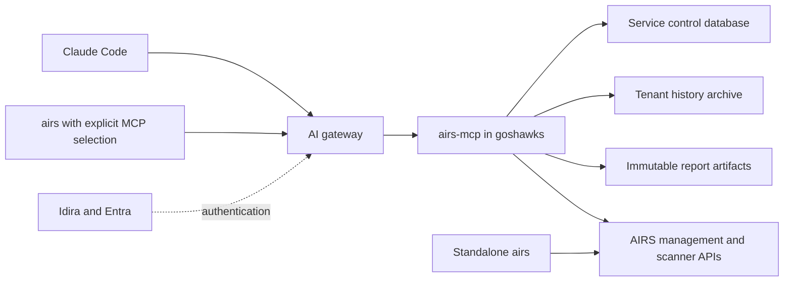

# Optional runtime MCP service implementation plan

Revision 7 — 2026-11-05 (revision 6 of 2026-11-04 amended by the M0.6 live
results; see "Revision 7 amendments" at the end of this section). Implementation is
gated on the independent acceptance record in [the plan review](RUNTIME_MCP_PLAN_REVIEW.md). This document specifies
the architecture agreed in the MCP scope interview. It does not certify an
implementation, deployment, or live integration.

Build an optional, independently deployed MCP server in this Rust workspace.
The service owns persistent runtime history, collection, scheduled Signal Briefs,
and database lifecycle operations. Claude Code and the CLI access it through the
Goshawks AI gateway. The ordinary CLI remains independently usable, including
its existing live report and offline evidence rendering.

The plan replaces the CLI-local delivery choices in
[the original history plan](RUNTIME_HISTORY_IMPLEMENTATION_PLAN.md). Its data,
privacy, reporting, portability, and scale requirements carry forward. Historical
A0–B3 reviews remain evidence about their reviewed source, not acceptance of this
new architecture. B4 is unfinished; B5 and B6 are unaccepted. New phases M0–M8
below require fresh independent Codex reviews of at least **9.1/10**, passing
checks, and no unresolved material findings. Claude Code must independently score
this plan at least **9.1/10** before implementation resumes.

### Revision 7 amendments (M0.6 live results)

These amend revision 6 and take effect only when an independent review accepts them.
Review 9 accepted amendments 1–3. Amendment 4 was added after review 9. The owner later withdrew amendment 4's checks (2026-11-07) and amendment 3's node-loss test (2026-11-08, permanent); see each amendment.
Evidence: `.local/dev/runtime-mcp/m0.6/receipts.md`; contract §2.2, §2.3 and §12.1.

1. **Per-backend binding: route/token-bound resolution adopted.** The Goshawks gateway
   (Prisma AIRS AI Gateway 2.32.0) signs `aud` = the organisation ID for every
   integration, uses one signing key, and does not forward custom headers on
   `oauth_auto`. The binding is therefore the upstream Entra token, verified on every
   request: `aud` = this service's API and `azp` = a confidential gateway client
   dedicated to this one integration (contract §2.2, with the replay analysis). It is
   **not** a cryptographic binding between the two tokens. Conditions, all required
   before M2 serves anything:
   - the gateway client is confidential-only (no public-client, SPA, implicit or
     federated issuance path) and is the only client consented to the API;
   - the client and its secret are used by this integration alone, and no other
     integration targets this backend URL (re-checked at every deployment, M8);
   - grants stay owner-aware: `(caller, client_id)` plus the exact `owner_object_id`;
   - regression fixtures use the measured shape: organisation-wide assertion `aud`,
     no route header, and refusal of another API, gateway client or tenant;
   - if the gateway later offers resolution 1 or 2, the service adopts it in addition.
2. **Stateless MCP transport.** The gateway forwards one backend session per
   (user, server) whichever agent is calling (M0.6 step 7.6). The service issues no
   MCP sessions; every request is authorized on its own tokens (contract §2.3). The
   "session/chunk reauthorization" item of the M2 gate becomes "per-request
   reauthorization; no session state; forwarded session IDs ignored".
3. **Node-loss evidence moves from M0.6 to the M8 storage gate.** The owner declined to
   take down a shared cluster node: every node carries production workloads, and no
   disposable node exists. This relaxes revision 6's rule against deferring
   feasibility questions to M8, for this one item only, and is bounded as follows:
   - M0.6 established the parts the design relies on: RWOP refuses a second pod,
     `Recreate` never overlaps, each owner records a fresh owner ID, and the UID 0700
     subtree is on ext4. Contract §9.3 (no automated force-detach while the old
     writer's state is uncertain) is unchanged.
   - Nothing between M1 and M7 is deployed with real data or credentials, so no data
     relies on node-loss behavior before M8.
   - M8.2 must run the node-loss test on a **dedicated, disposable** node (for
     example a temporary worker VM that hosts only the service) before any
     deployment is called accepted. It must record the old writer's state, the
     replacement's state, the volume attachment, refusal while ownership is
     uncertain, and safe reacquisition. A dual mount or unsafe reacquisition reopens
     the design. Shared production nodes are never powered off, isolated or drained
     for this test.
   **Withdrawn 2026-11-08 (owner), permanently:** the node-loss test is not a gate of M8 or of any
   phase, and no later revision reinstates it. The owner accepts the residual risk of an
   unannounced node loss on the basis M0.6 established (RWOP refuses a second pod,
   `Recreate` never overlaps, each owner records a fresh owner ID) and contract §9.3's
   unchanged design rule: no automated force-detach while the old writer's state is
   uncertain. Recovery from a lost node is an operator action (runbook §10).
4. **Two backup-policy checks move to M8 (review 9).** Contract §9.4 now holds the
   accepted backup policy. Two parts of it are facts not yet verified, and they become
   M8.1 deployment prerequisites:
   (a) record nas1's retention and deletion behavior for the nas2 → nas1 copy;
   (b) show that no agent-accessible credential, including the Coder workspaces'
   account-level Cloudflare token, can delete objects in the R2 backup bucket, or
   narrow those credentials until none can.
   No real data is stored before M8, so nothing relies on either check earlier.
   **Withdrawn 2026-11-07 (owner):** both checks described the reference environment's
   own backup chain, not the product. They are optional operator records now (contract
   §9.4 revised; runbook steps 4–5 optional; the checklist accepts `skip` with a reason).

## Confirmed product decisions

| Area | Agreed behavior |
| --- | --- |
| Service scope | Runtime collection, history, database lifecycle, and reporting. Other scan and management commands retain their direct CLI behavior. |
| Packaging | Separate MCP server crate and binary in this workspace, with its own container and deployment. Completely optional to use the CLI. |
| Supporting crates | Publish `airs-runtime-core` and `airs-mcp-client` in lockstep with `airs-cli`; keep history-store and MCP server workspace-only. This is an approved packaging design, not authorization to publish now. |
| Optionality | No MCP selection means standalone CLI behavior. Explicit MCP selection uses the service and never silently falls back to live collection. No SQLite dependency or local database fallback in the CLI. |
| Clients and routing | Claude Code and optional CLI client → AI gateway → private MCP backend in namespace `goshawks`. |
| Caller authentication | Existing Idira/Goshawks Entra delegation flow at the gateway; OAuth 2.1 on the gateway-to-MCP connection. Bonbon is the reference integration. The earlier no-auth proposal is superseded. |
| AIRS authentication | Server-managed management credentials and explicit application-bound scanner credentials. Caller tokens are not AIRS credentials. |
| Authorization | Reader, Operator, Administrator, enforced by the service with validated identity. |
| Tenant scope | One configured AIRS TSG at launch; credentials, jobs, history, and grants remain explicitly tenant-scoped. |
| Storage and availability | One active MCP instance, SQLite on a filesystem backed by persistent block storage; backups and tested restore. Restart and upgrade downtime is acceptable. |
| Jobs | Durable collection/report jobs survive client disconnect, expose job IDs/status/results, deduplicate submission retries, and support explicit cancellation. |
| Expired authentication | Bounded renewal and retry, preserving job identity, committed work, and API allowances. |
| Collection | Configurable 15-minute scan-log metadata collection; routine collection makes no Reports API calls. |
| Daily report | Start at local midnight in `America/Chicago`, covering the previous local calendar day. Follow CST/CDT. |
| Revisions | Preserve the original; create immutable revisions when relevant evidence changes during the next 24 hours. Revisions use stored evidence/cached snippets, without Reports API calls. |
| Delivery | Server retains HTML, JSON evidence, and Markdown review/prompt bundles; authenticated MCP retrieval first. Notifications are a near-term follow-up. |
| Retention | Indefinite until explicit pruning. Credential rotation, deletion of an application, and removal of configuration do not delete history. |

The sections below supply concrete engineering defaults for these decisions.
They are reviewable implementation choices, not additional claims of user approval.

## Existing work and required extraction

The current root package is `airs-cli` 8.2.0-dev.1. `Cargo.toml` directly depends
on bundled `rusqlite`; `src/lib.rs` includes `history`; scan/bulk/resume paths
call automatic local retention. Merely adding a server binary does not remove
database ownership from the CLI.

Reusable foundations include application-scoped credentials, normalized evidence,
immutable facts and receipt reconciliation, private storage admission, bounded
SQLite transactions, retry eligibility, cooldowns, and report rendering. Source
coupling remains in `history/retention.rs`, `history/sync.rs`, and command adapters
through CLI `Invocation`, output, signals, and tenant loading. Extract those
dependencies behind narrow data/transport/cancellation interfaces; do not copy
the whole CLI into the server or make the server depend on the CLI crate.

The B3 acceptance records 3,833 passing workspace tests and separately qualified
platform fixtures. Preserve those receipts and all subsequent unrelated working
tree changes, including the reviewed test-harness spawn fix. The new combined
source must be qualified again. Preserve the frozen 8.1.0-rc.4 test packages.

### Workspace boundary

| Package | Responsibility and dependencies |
| --- | --- |
| `airs-cli` | Existing CLI, direct AIRS operations, live report, offline evidence replay, optional MCP command adapters. Depends on core/client; never on history-store/server/SQLite. |
| `airs-runtime-core` | Normalized identities/evidence, privacy, analysis, HTML/review rendering, versioned service DTOs, SCM collection/client construction, credential validation and collection interfaces independent of CLI I/O. Depends on SCM =0.2.4; no SQLite or server listener. |
| `airs-history-store` | Server-owned archive repository, identity/path admission, reconciliation, retry state, transfer/prune/backup/recovery. Depends on core and qualified SQLite. |
| `airs-mcp-client` | Streamable HTTP, gateway OAuth client/session handling, typed tool calls and bounded artifact transfer. No database operations or backend credentials. |
| `airs-mcp` | Independent binary/library: protected MCP endpoint, authorization, durable jobs/scheduler, server configuration, collection worker, artifacts, and lifecycle orchestration. |

Keep the root package as the workspace default member. Ordinary CLI build/install
must not build or start the server. Explicit workspace checks cover all members.
Confirmed packaging: publish core and client support crates in lockstep with
`airs-cli`, using exact `=` versions plus workspace paths; mark history-store
and MCP server `publish = false`.
Publication itself remains a separate release action. M0 checks crate-name
availability without reserving or publishing names, qualifies package builds outside
the workspace, and records publication order (core, client, CLI). Keep MCP client
support compiled into the CLI by default, but entirely inactive without explicit
selection; measure and report its release binary-size delta. Server use/build stays
optional. The user explicitly selected the two-supporting-crate design. A later
change to this package boundary requires a plan revision and independent review.

Core owns `SecretSet`, `RecordingProvider`, URL admission, scanner credential
types/validators, `ReadBudget` and the shared live collector. A narrow `HistorySink`
interface replaces direct collector references to `history::sync::Sync`; the
server implements it and the standalone live collector uses a nonpersisting sink.
CLI presentation/config adapters remain CLI-owned. Scope secret registries per
request/job with bounded worker lifetimes; do not accumulate every OAuth lease
forever in a process-global registry. Do not introduce a generic plugin framework
or duplicate the pinned SCM SDK.

M0 verifies feature graphs for CLI-only and unified workspace builds: no SQLite
in the CLI graph, no `serde_json/preserve_order`, the pinned reqwest/SCM behavior,
and full parity with server packages included. Check transitive MCP/JWT/schema
dependencies rather than assuming an MSRV-compatible manifest proves compatibility.



## Authentication and authorization contract

### Gateway and caller identity

Bonbon's source ADRs describe delegated Entra authorization-code plus PKCE on
the upstream hop and a separate gateway-signed `X-User-JWT` identifying the agent.
Its use of the word OBO does not establish Microsoft's assertion-based OBO grant
on every hop. Their dated status includes pending-spike and identity-forwarding
setup notes, so they are a reference, not proof of the current deployed flow.

The service validates both tokens on every invocation, including artifact reads:
signature/approved algorithms, issuer, audience, expiry/not-before, Entra tenant,
allowed gateway client, and configured gateway organization/workspace. Use pinned
discovery/JWKS origins, bounded fetch/cache behavior and key rotation tests. Do
not accept a discovery URL, `jku`, issuer, or upstream endpoint from tool input.

The validated principal tuple is Entra `tid`, upstream `oid`, Idira assertion
`sub`, agent `client_id`, workspace, organization, and service tenant. The upstream
`oid` is an integration-owner constraint; it is not assumed to be the human making
each call. Key grants, idempotency and audit by `(Idira sub, agent client_id)` within
the canonical service tenant, retaining the entire validated tuple for attribution.
Explicit configuration admits the delegation relationship between integration owner
and caller/agent; never equate unlike identifiers or grant every caller the owner's
authority. Support multiple explicitly granted caller/agent tuples within the one
launch TSG; no single-human assumption. Missing or ambiguous binding denies access.

Require a signed per-backend audience/integration binding in the identity assertion,
validated alongside the Entra audience. If the gateway cannot emit that binding,
M0.6 must resolve the cross-backend replay threat before M1; workspace-only identity
is not silently accepted as equivalent. Unknown agents receive no access. Bonbon's
current optional claim checks do not establish this stronger binding.

An acceptable alternative must cryptographically bind the assertion to this backend
(for example, a dedicated per-integration signing key) or provide a demonstrated
route/token-bound equivalent with a written replay analysis. Short expiry, `jti`
and NetworkPolicy alone are not substitutes. A different binding mechanism needs
an explicit plan revision and independent review before extraction.

Start with delegated external access only. No anonymous, static bearer, or app-only
fallback. Internal scheduled workers execute service-owned schedules; they do not
impersonate a disconnected user's OAuth session. Metadata/health routes reveal no
tenant data. Protected-resource metadata advertises the qualified Entra resource
and scopes. TLS and NetworkPolicy admit only the intended gateway backend path.

M0 must specify and fixture-test the exact resource/scopes/audience combination;
M0.6 must prove it through the deployed gateway and identity providers before
extraction; M8 repeats proof on the final build. Bonbon needed its
MCP URL as an Entra identifier URI to match the gateway resource parameter, while
its access token audience remained the API client ID. Do not copy Bonbon IDs.

### Permissions and audit

Proposed resource permissions are `AirsHistory.Read`, `AirsHistory.Operate`, and
`AirsHistory.Admin`; M0 freezes the qualified identifiers. Effective authority
is the intersection of token permissions and server-configured tenant/principal/
agent grants. Admin includes Operator and Reader; Operator includes Reader.

| Permission | Service operations |
| --- | --- |
| Reader | History/status/coverage queries, job and schedule inspection, report listing and artifact retrieval. |
| Operator | Collection/backfill/enrichment/report submission, schedule management, cancellation, bounded receipt ingestion and attributed assessment submission. |
| Administrator | History import, prune, compact, backup/restore/recover, export of whole archives, artifact deletion, and lifecycle policy changes. |

Whole-history export is deliberately privileged; ordinary report retrieval remains
Reader. Destructive tools require a preview result followed by explicit execution
bound to its tenant, parameters, affected data generation, and expiring preview ID.
Changed selections require a new preview. Tool annotations are client hints, not
authorization. MCP caller identity does not prove that a human personally reviewed
an agent's proposed deletion; never label it as authenticated human approval.

Grants are per agent client ID, not merely per human. Default Claude Code grants
are Reader. Assessment submission and collection/report/schedule operations need
explicit Operator authority, further restrictable by an allowed-tool list.
Administrator lifecycle and
allowance-policy changes are denied to agent clients by default. A configured
administrative CLI client has separate grants and credentials/session identity.
If an agent is explicitly permitted to prepare an administrative action, execution
also needs a one-use, short-lived approval receipt issued through `airs mcp confirm
PREVIEW_ID` under that separately registered administrative CLI identity. Bind it
to the exact tenant, action, parameter digest, data generation and preview expiry;
changing any part invalidates it. The administrative session/credential must be
unavailable to the agent's execution context (for example, a separate account or
device), or approval requires fresh user-mediated authorization that the agent
cannot satisfy from a cached session. A different OAuth client ID plus a cache
readable by the same agent is insufficient. M0.6 tests denial from both the agent's
MCP identity and its shell/CLI execution context. Without that isolation or qualified
user-presence path, agent-initiated administrative execution stays disabled.

For the isolated-session option, the administrative account/device must be beyond
the agent's privileges, including its shell and credential stores; file mode 0600
under the same OS user is not isolation. For the fresh-authorization option, cached
sessions cannot satisfy confirmation: qualify the authorization server's freshness/
user-presence proof and its signed forwarding, reject stale/missing proof, and keep
admin refresh credentials out of the agent-accessible cache. `confirm` displays a
terminal-safe server preview and requires a controlling terminal and typed action
confirmation. A terminal alone is not human-presence proof. Ordinary `login` owns
browser flow; if confirmation needs fresh authorization it reports that requirement
and the exact preview to bind into an explicit login flow. Agents controlling the
administrative device/browser/account are outside this separation's threat boundary.
Test cached-session, noninteractive and stale-proof attempts, not merely wrong IDs.

The fresh-proof option applies to **every mutating execution under the administrative
identity**, including direct human-initiated preview/execute, approval issuance,
maintenance repair, quota policy and lower-tier mutations reached through that
identity. Its mutating grant is ineffective without fresh qualified proof bound
to the exact preview/operation, parameters, actor and server-issued nonce. Consume
that proof once at durable admission into one job/maintenance operation; retries
resolve to that same operation, never another. The authorized durable operation can
resume at its checkpoints without approving a new operation. A new preview, changed
parameters, expired/invalidated selection or separate mutation requires new proof.
Neither an admin access token nor a refresh token capable of authorizing another
mutation may remain in agent-readable storage. A recently refreshed access token,
a bare `auth_time`, a pty or a typed phrase cannot replace the operation binding.
Add explicit M0.6/M2/M7 tests where the agent's shell skips `confirm` and attempts
direct admin preview/execute or lower-tier mutation with a recent cached admin
session; every such execution is denied without the bound proof. The isolated
administrative-context option instead keeps the entire session outside the agent's
privileges, and its isolation must pass the same shell-context negative probes.
Read-only preview creation remains available under its declared grant so the bound
challenge can be prepared. Approval issuance and the resulting execution refer to
one authorized operation; confirmation cannot mint authority for a second action.
M0 freezes the proof-to-receipt-to-job atomic consumption and retry transitions.
Human-initiated administrative CLI operations still require explicit preview/execute
confirmation. This separation restricts an agent exposed to malicious scan excerpts;
it does not claim to prove that a person mentally reviewed the content. Test injected
excerpts attempting prune/restore/quota changes and direct approval-tool invocation.

Persist safe actor IDs, job/operation IDs, approved scope, policy revision, time,
and outcome. Never record tokens, secret-derived fingerprints, raw claims/bodies,
credential headers, or URL queries. Reviewer names inside Markdown remain
self-attributed; store authenticated submitting actor separately. Evidence and
prompt excerpts are untrusted data and cannot authorize tools or alter policy.

Accepted jobs survive token expiry. Before each resumed phase/new outbound batch
and destructive commit, check current server grants. A known revocation blocks
further work while preserving committed evidence. Service-owned schedules survive
the original creator's login expiry or personal grant removal. Operators and
Administrators may disable them; the service actor's current tenant grant must
still authorize every dispatch. Administrator-only authority applies to grant
and lifecycle policy changes, not ordinary schedule management.
External revocation visibility follows token validation/configured grant updates;
do not claim instantaneous directory revocation without a qualified mechanism.

### Credential/configuration ownership

The server owns strict TOML configuration for AIRS credentials, application
bindings, public tenant identities, gateway/Entra trust, and access policy. Use
the cluster's existing Conjur/ESO/Secret delivery pattern. Normal CLI TOML readers
continue rejecting unsafe permissions/symlinks. Server startup must copy an
admitted, bounded projected configuration into a private owned runtime file and
validate it before activation; do not weaken CLI file checks for Kubernetes mounts.
Reload atomically only after complete validation. Keep an explicit public config
revision for eligibility and audit; never derive identity from secret bytes.

CLI tenant TOML holds named MCP connections: gateway route, public OAuth client
registration, expected server tenant/TSG/environment, and approved discovery
origins. Tool requests carry public identifiers/parameters, never local AIRS
credentials or arbitrary upstream URLs. An MCP-only tenant needs no AIRS secrets.

CLI login uses the qualified gateway authorization-code/PKCE flow, loopback
callback, exact state/issuer/resource checks, explicit login/logout, and refresh.
No embedded client secret or token arguments. Store generated OAuth session
material in a private, versioned, atomically written cache separate from tenant
configuration and SQLite; document its format, locking, ownership, redaction,
rotation and logout deletion. Noninteractive commands never open a browser;
return a clear authentication-required error. Separate this session cache from
the existing bulk scan checkpoint format.

Only explicit `airs mcp login` opens a browser, even in a TTY. Put generated auth
state and operation receipts under the platform's private CLI state directory
(XDG state or the documented home fallback), with paths/formats frozen in M0.
Document token-cache refresh writes as generated session state; tenant/config
readers remain nonwriting. First MCP TOML namespace writes require the same private
rollback-snapshot/older-binary-refusal contract as the named-scanner upgrade.

Bind sessions and submission receipts to the canonical gateway resource, issuer,
OAuth client registration, connection revision and authenticated subject. Changes
invalidate reuse. Serialize refresh-token rotation across CLI processes; logout
affects only the selected connection/subject. Lost refresh responses can require
explicit reauthentication. One bounded authentication recovery may replay a
submission with its original idempotency key; retrieval/cancel retries never create
a new job. Invalidated unresolved submission receipts remain visibly unresolved;
connection changes/logout cannot discard them and silently start a replacement job.
M0 defines strict MCP tenant schema/versioning, dedicated connection
management, canonical old-format preservation and older-binary refusal.

Trust, principal grants, credential bindings and startup limits live in TOML.
Schedules and audited runtime allowance overrides live in control state, bounded
by TOML/compiled ceilings. Restored overrides/schedules remain inactive until the
recovery reconciliation; they cannot change the current TOML trust policy.

## Protocol and optional CLI behavior

Use the official Rust MCP SDK and Streamable HTTP, with an exact version selected
by M0's Rust 1.89, dependency-feature, transport and OAuth feasibility checks.
Record the actual negotiated protocol supported by Claude Code and the gateway;
do not assume newest-spec features or MCP Tasks support. Durable application jobs
are represented by ordinary typed tools and remain usable without Tasks.

Every tool accepts a versioned strict schema, fixed operation, public tenant ID,
bounded parameters, and where applicable an idempotency key. Reject unknown
fields/versions before effects. No arbitrary SQL, filesystem paths, executable
templates, shell commands, or user-supplied upstream endpoints. Error envelopes
carry stable codes, safe reasons, retry/credential status, and job IDs, never raw
SDK/SQLite errors. Listing is paginated with cursors bound to scope and snapshot.

Proposed groups: `service_info`; `history_status/coverage/query`; `collection_start`;
`reports_create/list/get`; `artifacts_read`; `jobs_list/get/cancel`; `schedules_list/
set/disable`; `receipts_ingest`; `assessments_submit`; and Administrator lifecycle
preview/execute plus staged upload tools. M0 freezes exact names, permissions,
limits, result schemas and compatibility fixtures before implementation.

Proposed CLI grammar adds named `--mcp CONNECTION` selection to runtime report,
sync, history, jobs and schedules, plus explicit `airs mcp login/logout/status`.
History/sync/job/schedule commands require that selection; otherwise produce a
usage error explaining that the optional service is needed. Existing live
`runtime report` without the option remains unchanged. `--from-evidence` stays
offline and conflicts with MCP selection before any tenant or network access.
Service commands cannot accept `--history-dir`; the service never accepts client
filesystem paths. Remote report output is downloaded to the existing private,
no-clobber bundle/output destination; local output failures preserve the server job.

Default CLI behavior has zero MCP calls, zero SQLite access, and no server startup
or package requirement. An unavailable explicitly selected MCP endpoint fails
operationally; it cannot reset budgets by falling back to the live collector.
Version/capability mismatch is explicit. Preserve stdout/stderr, quiet behavior,
exit 0/1/2/130/143, argument validation order and current direct APIs.
Ctrl-C/SIGTERM while waiting exits 130/143 and reports the known remote job ID
without canceling it; reconnect with `jobs get`. If admission is unresolved,
retain/display the operation receipt instead. Remove unpublished local-only
`--history-dir`/`--no-history` flags from direct scan/bulk/resume, documenting the
new explicit retention opt-in and matching DESIGN/parity differences.

Replace B2 local receipt retention with **explicitly opted-in remote retention**:
proposed `--record-history CONNECTION` on direct scan/bulk/resume. Those commands
still scan directly. Only already-received, normalized metadata is sent to MCP
after essential bulk checkpoints; no additional AIRS lookup or resubmission.
Batch at 200 records/256 KiB; permit at most a two-second overall remote-retention
wait per completed command, use bounded memory, and warn once for unrecorded
results without changing the scan outcome/exit. No local database or durable
receipt spool. No interactive login in this path. Stable receipt IDs make retry
safe; scanner revision mapping requires an admitted server-side association,
not trust in a client-supplied credential reference. Unresolved receipts stay
outside attributed totals. Standalone scans simply retain their normal outputs
and bulk checkpoints. Preserve archived local files; explain this change from
the unpublished local-history development build rather than deleting user data.

Remote receipt content has immutable `client_asserted` provenance. Authentication
and a configured scanner association do not prove the claimed scan response was
received. Even a complete identity cannot independently establish provider coverage,
verdict/action, report ownership, or provider-derived population counts. Corroboration
requires server-observed API evidence under the existing full-identity predicate.
Attribution attaches the receipt to that event without elevating its trust; only
corroborated server facts affect authoritative aggregates. Preserve unverified
claims/conflicts separately and label their source in queries/review packets. Test
a validly authenticated client forging a complete identity and malicious/allow/block
claims, and both receipt-before-provider and provider-before-receipt arrival.
Client assertions cannot demote or corrupt a provider-derived attribution solely
by contradicting it. The ingestion grant maps `(caller sub, agent client_id,
declared scanner name)` to the server's application/binding reference, and the
local canonical cloud must match the selected service cloud. Do not trust client
revision UUIDs. Add explicit `receipts upload --from-bulk-state PATH` to retry
eligible retained metadata from validated existing bulk checkpoints without AIRS
calls or new payload storage. Where the checkpoint lacks metadata, report that gap;
never claim all bulk results were retained within the two-second automatic budget.

## Storage, recovery and durable jobs

### Single active service and storage boundaries

Keep existing canonical cloud identity and per-cloud history archives. Add a
server control SQLite database for jobs, schedules, submission identities,
publication records and service API quotas. It contains no credentials. This
separates active control state from portable history imports/restores, preventing
an old archive from reviving jobs or resetting today's Reports allowance.

Use fixed, parameterized schemas and versioned migrations in both stores. Never
hold a transaction in one database while opening a transaction in the other.
Do not claim atomic cross-database commits: stable job/operation/fact IDs plus
reconciliation resolve each crash window. The control journal reserves transport
before sending; archive writes are idempotent and identified by operation ID;
completion is marked only after checking the committed archive operation.

The control store is authoritative for live cooldowns, credential-denial revisions,
retry ordinals, daily/job allowances, submission tombstones and deletion/publication
fences. Archive copies of prior operational provenance cannot roll them back.
Key allowances by canonical cloud identity, not a renameable tenant nickname.

Reuse owned 0700 directories/0600 files, no symlinks/foreign ownership, DELETE/FULL
journaling, secure_delete, immutable facts, conservative reconciliation, and fixed
lock order. No network operation, output rendering or user interaction occurs
inside an archive transaction/gate. Preserve two-second ordinary coherent read
budgets, bounded write batches, explicit maintenance exclusion, and measured
memory limits. A 256 MiB SQLite allocator limit is not a total process RSS claim.

Use one active pod and a filesystem backed by block storage, not RWX/NFS. Prefer
ReadWriteOncePod if the installed CSI driver supports it; RWO alone does not
enforce a single pod. M0/M8 must prove exclusive ownership and no overlapping rollout
(node-loss fencing is not a gate: revision 7 amendment 3, withdrawn). If RWOP is unavailable, qualify an
equivalent fenced single-owner deployment before enabling collection; do not
pretend an advisory local lock is distributed fencing. Preserve PVCs on teardown.

Use a fixed non-root runtime UID and read-only container root filesystem. Do not
apply a group-writable `fsGroup` to admitted archive paths. A constrained init step
creates only the dedicated UID-owned 0700 data subtree on the root-owned block
filesystem; it cannot recursively repair arbitrary existing archives. M0 tests
the real ancestor/mount permission shape and M0.6 checks it on disposable storage.

### Startup and maintenance recovery

The current ordinary reader refuses hot/unfinished rollback journals. Server
startup therefore has an explicit administrative recovery stage before readiness:
hold exclusive ownership, validate paths/versions, preserve private recovery
material, verify recovery on a copy, and invoke the existing guarded recovery
protocol. Never delete/reinitialize a failed database or silently downgrade it.
Control and archive recovery finish before job claims or scheduled work begin.
Failure leaves data intact and exposes maintenance-required health. Distinguish
authenticated transport readiness from ordinary-operation readiness: the Kubernetes
Service continues routing to an authenticated maintenance-capable process while
ordinary tools return `storage_unavailable`. Its operational-health endpoint and
metrics remain failed until recovery completes. If trust/config verification itself
fails, neither normal nor maintenance operations become available.

Provide authenticated maintenance mode in the same server binary for recovery
when the ordinary job database cannot open. It admits only bounded Administrator
inspection/restore/recover operations with a private durable operation manifest;
ordinary collection/jobs remain disabled. Qualify retry/disconnect/crash behavior
of this mode separately; it is not an unauthenticated repair backdoor.

Keep maintenance previews, one-use receipt consumption and recovery-epoch changes
in its validated private operation manifest when the control database cannot open.
Refuse agent-prepared administrative execution entirely in maintenance mode;
only the isolated/freshly authorized administrative client can invoke repair.

Backups must be SQLite-consistent, private, checksummed and independently restorable.
Coordinate control/archive/artifact snapshots under exclusive maintenance, release
locks before slow off-volume copying, and record a complete manifest. A retained
PVC or Longhorn storage replica alone is not a verified backup. Restore validates
identity/schema/integrity and stages before replacement; preserve current control
reservations/audit and never automatically replay restored active jobs/schedules.
If the control store itself is restored or lost, require explicit administrator
activation and a new recovery epoch. Old submission keys are valid only in their
original epoch; unresolved clients cannot silently resubmit under a new epoch.
Quarantine outbound collection until restored reservations/denials/cooldowns have
been reconciled. For unknown cooldown state impose at least 24 elapsed hours from
recovery activation, retaining any known later deadline; midnight alone cannot
clear uncertainty. Unknown prior attempts remain exhausted and credential-denied
work remains blocked until explicit audited reconciliation establishes eligibility.
Keep schedules inactive until that reconciliation; restoration cannot grant a new
Reports allowance. Preserve current tombstones when available; if deletion/publication
fences cannot be established, quarantine old artifacts and require explicit reviewed
reactivation rather than automatically exposing or reattaching them. Record lost
progress as unknown. Never claim a backup predating deletion preserves that deletion.

M0.4 must name the independent backup target/access policy, encryption and key
recovery, cadence/RPO, explicit retention/deletion policy and restore-drill interval
before schedules are enabled. Proposed defaults are an encrypted daily application
backup (24-hour RPO), kept until explicit pruning, and a monthly isolated restore
drill. Use the cluster's qualified off-volume backup facility; if no target/key
custody can be established, deployment remains blocked instead of counting a local
PVC copy as the backup. Backups inherit snippet sensitivity and explicit lifecycle
inventory. M0.6 proves a small restore; M8 repeats it at the qualified dataset size.

### Job state machine and idempotency

States: `queued`, `running`, `waiting_retry`, `needs_credentials`, `blocked_policy`,
`cancel_requested`, `canceled`, `succeeded`, `partial`, `failed`. Persist normalized
immutable parameters, scope, policy/config revisions, submitter, scheduled slot,
attempt reservations, checkpoints, and result/artifact identities before returning
an accepted job ID. Service-owned schedules use an explicit service actor.

An idempotency key is scoped to tenant, authenticated submitter, operation and
server recovery epoch (unchanged by routine restart).
The same key and canonical parameter digest return the same job; a different
digest is a conflict. Durable tombstones prevent reuse after lifecycle deletion.
The CLI also retains its submission key in a private bounded operation receipt
until it resolves the job ID, so a lost response or login retry cannot silently
become a new submission. This receipt contains no token or database and is not a
scan-payload spool. MCP clients can supply/reuse the key explicitly.

One active collection per tenant; queued overlapping equivalent requests join or
defer to the recorded collection without falsely relabeling its scope. Read/report
jobs obey the archive's short snapshot budget; exclusive maintenance announces
busy state instead of starving ordinary reads. Fair bounded queues reject overload
with retry metadata. M0 freezes queue/range/body ceilings and operation deadlines.

Cancel explicitly at checkpoints, before new outbound attempts and before
publication/destructive steps. Already committed evidence remains. Disconnect,
HTTP cancellation and caller-token expiry do not cancel an accepted worker job.
On restart reclaim unfinished work only after recovery/ownership validation;
uncertain API attempts stay consumed. No exactly-once promise for external APIs.
Persist artifact publication and archive-operation identities so idempotent
reconciliation can distinguish completed work from unfinished work.

### Expired credentials and API budgets

The current collection budget forces SDK retries to zero. A rejected OAuth lease
can be invalidated without replaying the original read. Implement one explicit,
accounted fresh-token replay at that management-read boundary for an eligible
authentication rejection. Keep transport retries disabled and preserve the SDK
provider's concurrent renewal/generation protections. A management renewal is a
client-credentials token exchange, not a user refresh-token exchange. Record every
obtained lease in SecretSet and every actual OAuth/API send in the durable journal.

Use one stale-token replay on an eligible management 401, never on 403. A second
401 after fresh-token replay is a permanent credential denial, not a transient
retry. Permanent credential/permission rejection
enters `needs_credentials`, with no repeated sends using the same rejected credential
revision. Token-endpoint 429, 5xx and transient transport failures instead enter
bounded `waiting_retry`, respecting cooldowns, deadlines and existing reservations.
Maintain management/scanner credential revisions separately from general configuration
and policy revisions; an unrelated reload cannot reopen rejected credentials.
Scanner API keys/tokens have no adapter renewal flow: retain the existing
application/revision-wide denial and require a compatible rotated binding.
Validated same-scope credential replacement can automatically resume unfinished
eligible work, subject to current authorization, original deadlines and allowances.
Endpoint/app/TSG rebinding cannot silently retarget a job.

Preserve work retry spacing/attempt caps and cloud/service cooldowns. Honor both
Retry-After forms and backward-clock protection. Reserve before HTTP; only proven
no-send releases a reservation. Never retry an entire job to obtain a fresh budget.

Reports enrichment remains strategic: five IDs by default, ten maximum, at most
two actual report transports per logical job across all credentials, serial sends,
cached-example reuse, and stop on 429. Persist those limits in the control journal.
Additionally default to **two Reports transports and ten distinct IDs per service
tenant/`America/Chicago` calendar day across all jobs**. A new job ID, credential rotation,
restart or reauthentication cannot reset that shared allowance. Administrator
policy can explicitly lower/raise the service allowance with audit up to compiled
ceilings of ten actual transports and fifty distinct IDs per tenant/day; per-job
hard caps remain. Raising the compiled ceiling is a separately reviewed code change.
Standalone CLI calls retain their own existing bounds and are outside
this service's accounting; never claim the service controls every external user.
Charge each send to both its original logical job and the actual admission-day
allowance when it crosses midnight. A stored day/high-water guard prevents
wall-clock rollback or timezone/policy changes from reopening an earlier allowance.

## Collection and daily report scheduling

Collection ticks at UTC quarter-hours by default, with a configurable interval.
Persist schedule versions and deterministic tenant/schedule/slot keys. Duplicate
ticks deduplicate. Missed collection ticks coalesce into one bounded catch-up job,
not a burst of fifteen-minute jobs. First collection requests the recent 24 hours;
older backfill is explicit, bounded by actual SDK/API capabilities, and never
claims a server-side historical cursor. Preserve head requery, overlap, dedup,
unknown timestamps, falling-behind state, and honest coverage gaps.

For an ordinary tick, derive the desired lower bound from the last traversed-as-of
point minus a 15-minute overlap; use the narrowest supported rolling selector
covering it (minimum one hour where the SDK only admits hours), then filter locally.
Advance progress only for valid traversal of each application/source; incomplete
coverage cannot move the next lower bound beyond unobserved records. The request
cap yields explicit partial/falling-behind state and preserves that unfinished work.
A delayed job may need a wider selector but cannot persist moving page offsets.
Default each tick to 120 seconds, 200 total HTTP sends including OAuth, 40 pages
per source and existing bounded result-row/byte limits; ceilings are validated
configuration, not a fresh allowance per application. Record exact selector, request
counts, unfinished work and gap age. Inventory/profile sampling may be cached when
unchanged, with its observation age disclosed. M4 measures sends per tick and daily
management/Results totals; it must not perform 96 unconditional 24-hour traversals.

At `00:00 America/Chicago`, queue the previous local calendar day's report using
half-open UTC bounds. A day may span 23, 24 or 25 hours. Capture existing evidence
without waiting for the simultaneous collector. Persist scheduled time, actual
snapshot/as-of time, timezone, timezone-data version, bounds, and coverage. If
maintenance delays the report, retain its intended date and disclose the delay.

Daily example enrichment is **disabled until explicitly enabled** in the schedule.
When enabled, one separately identified job after the first post-midnight collection
selects up to five strategic examples for that report's period, subject to the shared
allowance above. An Operator may enable it; allowance increases remain Administrator
operations. On-demand enrichment is also explicit. It stores evidence once. The daily
report/revision renderer itself performs zero network collection. Routine polling,
retrieval, and revision generation make zero Reports calls. If no credential,
candidate or allowance is available, publish with an explicit evidence gap.

The reconciliation window ends **24 elapsed hours after scheduled midnight**,
regardless of delayed completion or DST. Each committed evidence change can enqueue
a deduplicated revision; coalesce equivalent pending revisions. Compare a canonical
digest of report-relevant evidence/rules, excluding observation-only timestamps,
run UUIDs and rendering time. Keep original/version IDs immutable and link each
revision to its predecessor; update the authenticated `latest` pointer atomically.
Debounce automatic revisions to at most one every four elapsed hours by default,
including a final changed-evidence revision at window close: at most six automatic
revisions plus the original. The configurable interval is at least one hour, with
a compiled maximum of 24 automatic revisions per report; the final revision uses
that allowance. Evidence changes still enter history immediately. Identical digests
produce no new bundle. Test a full day of changing evidence, not only queued-job
coalescing. Manual regeneration is an explicit new report, subject to storage quota.
Anchor default revision opportunities at +4, +8, +12, +16, +20 and +24 elapsed
hours from scheduled midnight. Coalesce delayed opportunities and reserve the
last allowance for the final snapshot; do not shift the final cutoff after delays.
For other configured intervals, anchor earlier opportunities at integer multiples
of that interval strictly below +24 hours, then include one final +24-hour slot
within the hard allowance; a non-dividing interval cannot postpone the final slot.
Evidence arriving after the window remains in history and can be included by an
explicit new report, but does not silently rewrite a published artifact.

After downtime, create one catch-up report per missed daily slot from retained
history, serially and in bounded batches; do not fetch old report examples or
invent midnight snapshots. Label actual as-of time and incomplete coverage. Do not
replay expired revision windows or create automatic revision windows for catch-up
reports. Schedules record last completed slots and backlog;
disable/change operations have explicit effective times and never erase history.

## Historical reports and artifact delivery

Preserve malicious verdict versus administrator allow/block as separate dimensions;
malicious + allow can be intentional monitor mode. Unknown/conflict/missing evidence
never becomes benign. Maintain full five-part event identity and conservative
receipt promotion. Distinguish provider aggregates, observed scans and sampled
examples; do not sum overlapping aggregate windows or extrapolate detail samples.

Historical HTML implements the previously planned, not yet delivered, offline
date/application/detector/verdict/action filters,
consistent counts/charts/tables, profiles on rows and detection services on columns,
observed profile timelines, and explicit coverage. Select posture at/before period
end; never use future configuration as historical fact. Keep full cohort summaries
separate from capped detail. Preserve 50,000 summary-cell, 10,000 detail-row and
32 MiB interactive-HTML thresholds and the existing documented fallback behavior.
Qualify 30/90-day coherent queries on at least one million synthetic distinct scans.
These controls change the current script-free output: use hashed-script CSP,
HTML-injection fixtures, accessible no-JavaScript/print behavior and explicit
DESIGN §12/parity coverage rather than claiming existing interactive behavior.

Each bundle contains `report.html`, `evidence.json`, `review.md`, and a service
manifest binding tenant, job, period, version, content hashes, analysis/redaction
versions and completeness. The Markdown retains its embedded coding-agent prompt
and evidence digest. No server-side LLM is needed for generation. Agent assessments
are explicit, attributed inputs and never overwrite source evidence or masquerade
as human review. Privacy filtering and HTML/terminal safety apply to every surface.

Default Operator agent allowed-tool lists exclude schedule changes, enrichment
enablement and allowance changes; these require explicit grants. Limit manual
report admission to four jobs per principal per rolling hour and 24 per tenant/day
by default, with a compiled tenant ceiling of 48/day. Automatic scheduled/revision
jobs use their separate deterministic limits. Quota is charged at admission and
retained through retries; cancellation cannot manufacture new capacity. M0 freezes
override permissions and overload responses. Storage reservations still apply.

Publish through private owned staging, bounded generation, hash verification,
file/directory fsync and no-clobber rename. Then associate the manifest in control
state and record a completion event. Reconcile publish-before-commit crashes from
the immutable manifest; remove only verified owned unfinished staging. Never return
`succeeded` for an unverified or missing bundle. Partial reports remain retrievable
with a `partial` result and explicit gaps; strict CLI mode maps that to exit 1.

Serialize each report's version-chain/latest-pointer updates. Bind render snapshots,
staging manifests and publication intents to a report-relevant evidence generation
and the control store's deletion fence. A shared lifecycle/publication gate excludes
final publication while prune/artifact deletion advances that fence; recheck immediately
before activation. Hold no cross-database transaction while doing so. A stale renderer
must requery or stop, never publish removed snippets. Restart reconciliation honors
tombstones/fences and quarantines stale orphan bundles rather than reattaching them.
Prune with selected artifact deletion covers affected in-flight publications too.

Separate agent reading from byte-exact CLI download. Agent-facing report/review
tools return paginated UTF-8 summaries or Markdown segments capped initially at
16 KiB serialized JSON, including metadata, under measured Claude output limits;
no giant HTML/base64 payload enters the conversation. CLI-specific artifact transfer
uses up to 64 KiB raw bytes per chunk inside a <=256 KiB response, qualified through
the gateway. Use server-issued IDs, offsets and manifest hashes, not filesystem
paths or arbitrary URLs. Stream downloads to private temporary files and verify
total length/hash before publishing; checkpoint transfer offsets for reconnects.
Measure the call count and elapsed time for a 32 MiB artifact rather than treating
hundreds of MCP calls as free. Smaller bounded responses are the fallback if the
gateway cannot support the proposed binary chunk size, never public download URLs.
No public artifact URLs. Reauthorize each chunk; ownership/tenant checks apply to
guessed IDs and pagination. Qualify gateway/Claude payload behavior in M0 and M8;
reduce chunk size if needed. Resources can be added as a convenience only after
the gateway supports them; retrieval cannot depend on unqualified Resources/Tasks.

Persist completion events without a sender. Future notifications consume these
events with their own durable delivery IDs/retries and access-controlled links.
No email, chat, webhook or other outbound notification is provisioned in this phase.

### Capacity and low-space behavior

Set a 64 MiB total bundle ceiling in addition to the 32 MiB HTML ceiling. At the
default maximum of seven versions, artifacts alone can consume 448 MiB per report
day, about 160 GiB per year before backups. The compiled 25-version maximum is
about 570 GiB per year. These are worst-case bounds, not predicted usage. Capacity
planning adds measured archive/control growth, import staging, recovery copies and
independent backup retention; indefinite retention does not imply unlimited disk.

Before admitting writes, reserve at least twice the combined database bytes for
maintenance, two maximum bundles for publication, active transfer reservations,
and 64 MiB of control/journal headroom. Publication pauses before that reserve is
reached (default additional margin 512 MiB); collection pauses at the reserve.
Validate capacity at startup and recheck before allocations and commits. Report
low-space/backlog state through health/metrics; never silently prune, lose the
last valid bundle, or mark paused collection complete. Bound simultaneous import,
backup and render reservations so each does not spend the same free space. M0
sets the deployment's PVC capacity from this model; M8 measures capacity. (The
low-space exercise on the actual storage class was withdrawn by the owner on
2026-11-08, permanently; the low-space behavior is covered by the service's tests.)

## History transfer and lifecycle

Complete unfinished B4 behavior in the server: validated legacy-bundle import,
bounded portable JSONL transfer, coverage/status/statistics, previewed selective
prune, compaction, recovery and backup/restore. Preserve cloud identity, immutable
fact variants, provenance, conflict handling and partial-import disclosure. Input
is data, never SQL/schema/pages. Validate full staged digest/relations before
destination mutation; bounded idempotent import resumes after partial commits.

Transfer uploads use private server-assigned staging IDs, bounded chunks, hashes,
declared total length and explicit finalization. Preserve the existing 1 MiB line
and 16 GiB transfer ceilings, per-tenant staging quotas, and cleanup of abandoned
incomplete uploads. Reauthenticate/authorize every chunk/finalize. Never activate
imported schedules, active jobs, credentials or authorization policy. Preserve
historical run evidence while isolating it from live control/quotas.

Prune previews enumerate facts, receipts, projections, examples, coverage, report
versions, transfer artifacts and known backups that contain affected data. Database
pruning does not imply that old immutable bundles or external backups were erased.
Offer an explicit separately selected artifact-deletion scope, retain tombstones,
and remove references before deleting only verified owned files. Defaults preserve
published reports. Document recovery copy/snapshot limitations and make no forensic
erasure claim. When detail is removed, coverage cannot become a covered zero; remove
all live snippet copies and prevent promotion/rebuild/import from resurrecting them
except an explicit separately authorized import of that data.

Migrate existing local development archives through the server's explicit import
workflow. The service can stage a bounded private owned copy from a read-only mount of
the recognized old schema, validate cloud identity and ownership, produce a logical transfer,
then import into new storage. The CLI transfers bytes or existing bundles; it never
opens SQLite. Preserve the original and a verified rollback backup. Unknown/newer
schemas are refused. User data stays untouched unless an explicit migration is run.

## Delivery phases and review gates

Each chunk ends with a concrete artifact and relevant tests. Independent acceptance
reviews evaluate the actual source diff and frozen verification evidence; a reviewer
must not implement the chunk being scored. A score below 9.1 triggers fixes and
another review, preserving previous findings/scores. No phase inherits B3's score.

| Phase | Chunks and deliverables | Exit gate |
| --- | --- | --- |
| **M0 Contract and integration feasibility** | M0.1 freeze package/API/CLI/config/job schemas and limits; M0.2 pin Rust MCP/OAuth/JWT/timezone dependencies and build minimal loopback server/client on MSRV; M0.3 specify Bonbon-derived token binding, scopes, PKCE/cache and gateway fixtures; M0.4 specify SQLite control/archive transactions, recovery, backup and singleton ownership; M0.5 update DESIGN/COMPATIBILITY roadmap and compatibility fixture inventory; M0.6 user-run disposable gateway/identity/CLI/storage feasibility spike before M1. | Reviewed contract, compiled dependency/transport prototype, packaging choice resolved, and actual feasibility receipts. Loopback evidence alone cannot pass this gate. |
| **M1 Extract core and remove CLI database ownership** | M1.1 extract privacy/evidence/collection interfaces and renderers; M1.2 move SQLite/repository/reconciliation/work/transfer to server-owned package; M1.3 remove local retention adapters and migrate their tests to server domain; M1.4 retain direct/offline CLI behavior and package dependencies correctly. | CLI package graph excludes SQLite/server; direct CLI parity passes; old history/reconciliation/privacy tests exercise extracted code; no loss of frozen release artifacts. |
| **M2 Protected MCP endpoint** | M2.1 Streamable HTTP, metadata, safe envelopes and limits; M2.2 two-token verification, explicit identity mapping and grants; M2.3 tenant-isolated read tools and audit; M2.4 config staging/reload and private health/maintenance routing. | Allow/deny fixtures cover invalid issuer/audience/owner-agent/workspace bindings, stale/revoked grants, per-request (stateless) and chunk reauthorization, ignored forwarded session IDs, the measured org-wide assertion audience bound by the upstream token, safe errors and no auth fallback. |
| **M3 Durable control state and recovery** | M3.1 job/idempotency/cancel/state schema; M3.2 cross-database operation reconciliation and singleton worker ownership; M3.3 startup/maintenance recovery and consistent backup/restore; M3.4 fair bounded dispatch, policy checks and durable transport allowances. | Crash-point tests prove reservation-before-send, deduplication, cancellation, no budget reset, control-restore restrictions and preservation of corrupt/original data. |
| **M4 Collection, credentials and schedules** | M4.1 move collector to service context; M4.2 explicit OAuth renewal/replay and credential-blocked resume; M4.3 quarter-hour collection/dedup/catch-up; M4.4 sparse example enrichment with daily/job quotas; M4.5 bounded normalized receipt ingestion. | Repeated auth/429/timeout/restart cannot multiply traffic or change identities; missing data stays partial; polling has zero Reports calls; late/duplicate receipt ordering remains correct. |
| **M5 Transfer and lifecycle completion** | M5.1 complete B4 codec/type/integrity gaps; M5.2 staged MCP uploads/export and old-archive migration; M5.3 preview/execute prune, artifact deletion and tombstones; M5.4 compact/restore/recover through service tools. *Scope reconciliation (M5 review 2): restore and epoch activation are offline maintenance (`airs-mcp control-*`), artifact deletion moves to M6 with the report artifacts it deletes, and M5.4 online is compact and recover; see contract §5.1.* | Adversarial valid-checksum inputs, orphan/duplicate/projection forgery, erased identity, unowned report, array-valued work scan ID, wrong cloud, boundary records, interrupted imports and all-copy pruning pass; run crates/airs-history-store/tests/support/history_transfer_adversarial.rs against the new service adapters; no client SQLite. |
| **M6 Historical daily reports and retrieval** | M6.1 full-cohort queries/HTML filters/profile matrix; M6.2 midnight/DST windows and immutable 24-hour revisions; M6.3 private crash-safe bundles, hashes/latest pointer and chunked retrieval; M6.4 assessment attribution and completion events. | Golden report/coverage tests plus DST/missed ticks/late data/publication crashes, cardinality thresholds and unauthorized retrieval. Render/revision/retrieval makes zero Reports calls. |
| **M7 Optional CLI client** | M7.1 named TOML connection management and interactive OAuth/cache; M7.2 explicit service history/sync/report/jobs/schedules/lifecycle adapters; M7.3 bounded receipt opt-in and resumable artifact transfer; M7.4 diagnostics/help/docs/parity and packaged CLI installs. | No-MCP CLI remains independent; no silent fallback, auth prompts on noninteractive calls, secret leaks, scan resubmission or SQLite dependency. End-to-end loopback CLI→gateway fixture→server flows pass. |
| **M8 Deployment, scale and release qualification** | M8.1 container/singleton block PVC/Secrets/TLS/NetworkPolicy/health/metrics and GitOps artifacts; M8.2 million-scan and contention benchmarks, the coordinated backup at the planning size, restore/volume qualification, and measured capacity (runbook §12); M8.3 real gateway/Claude/CLI deployment runbook and user-run proof, including gateway client and credential exclusivity (runbook §7a); M8.4 all platform builds, the release image built and recorded from the release commit, source/package hashes, docs and release procedures. **Withdrawn by the owner, not gates:** the backup-policy checks of revision 7 amendment 4 (2026-11-07), the node-loss test of amendment 3 (2026-11-08, permanent) and the low-space exercise on the actual storage class (2026-11-08, permanent). | Independent >=9.0 review (owner-set threshold, 2026-11-06) of source, receipts and the actual integration evidence before deployment is called accepted. No automatic publishing merely because tests pass. |

M0 establishes contract-level dependencies before parallel implementation. M2 and
the domain portions of M3 may proceed independently after M1, in non-overlapping
files; integrate/review their combination before M4. M7's OAuth/client prototype
belongs in M0 even though complete CLI integration is M7. M8's manifests and
synthetic benchmark fixtures can be prepared early; final qualification always
uses the final combined source. One merge owner controls this checkout.

### M0.6 deployment feasibility before extraction

Before M1, prepare and have the user execute an authorized disposable feasibility
spike through the actual Goshawks gateway, Idira and Entra. Use a protected trivial
info/echo backend with no AIRS credentials or customer history. Automated repository
tests remain loopback-only. Record sanitized, allowlisted claim shapes and expected
test-principal associations, never raw tokens, authorization codes or secrets.

Prove Claude Code → gateway → backend; Entra resource/scope/audience behavior;
signed identity assertion caller/agent/workspace/organization/backend binding;
the CLI's registered public-client loopback PKCE login, refresh and interruption;
the separate administrative-client approval path; protocol negotiation and bounded
UTF-8/binary tool responses. Test a mismatched caller/agent/backend denial, not just
one successful call. Verify fixed-UID/private-subtree admission, single-owner CSI
access (RWOP or an independently demonstrated equivalent), and a small encrypted
backup/restore on disposable storage.
Also demonstrate concurrent-owner refusal. Node-loss behavior is not tested at any
phase (revision 7 amendment 3, withdrawn by the owner). Do not automate force-detach
while old-writer ownership is uncertain. The final storage tests in M8 remain a design
gate: failure reopens the design, not merely an operational warning.

Capture the exact versions/configuration references and a narrowly scoped result
receipt. If a required signed binding, OAuth flow, response bound or storage
guarantee is unavailable, resolve the design and re-review it before M1. Do not
weaken authentication or defer these feasibility questions to M8 (revision 7
amendment 3's node-loss item and amendment 4's backup-policy checks were later
withdrawn by the owner). M8 repeats
integration/restore proof on the final implementation and full qualified dataset.
Preparing the spike is authorized planning/implementation work; its real resource
changes and user sign-in are separate concrete execution steps, not a claimed pass.

No release is cut from intermediate M1–M7 source while optional CLI integration is
incomplete. The existing qualified RC packages remain the standalone test baseline.

## Validation and acceptance evidence

Required repository checks remain:

```sh
cargo fmt --all --check
cargo clippy --workspace --all-targets -- -D warnings
AIRS_REQUIRE_PARITY=1 cargo test --workspace
```

Use Node 24 and the exact frozen TypeScript reference. No parity skip, SDK checkout
modification, v7 tag deletion, or contact with non-loopback hosts in automated
tests. Preserve harness sandbox/mutation guards. Extend synthetic endpoints for
OIDC/JWKS, gateway forwarding, token rotation, lost responses and MCP transport.
Tests must prove useful negative controls, not merely mirror implementation.

Add focused suites for the following contracts:

- No-MCP dependency/call/filesystem behavior; explicit-mode validation before config;
  direct CLI/offline report parity; behavior and §12/DNN documentation consistency.
- Entra/gateway token and owner-agent binding, permission intersections, tenant IDs,
  discovery redirects/SSRF, refresh concurrency, expiry versus real denial, and no
  token material in archives, caches' diagnostics, tool output, exports or artifacts.
- Idempotency under lost accepted responses/relogin, disconnect versus cancellation,
  restart checkpoints, stale policy, duplicate worker admission and overload.
- Every reservation/publication crash boundary, conservative uncertain sends,
  two-send/ten-ID quota across jobs/restarts/credential changes, and 429 cooldowns.
- Spring/fall DST, midnight collector races, duplicate and missed ticks, clock
  rollback, delayed snapshots, 24-elapsed-hour cutoff and evidence-only revision
  digests. Midnight reports may be partial; tests must not assume all logs arrived.
- Transfer validation before mutation, valid-checksum malicious data, stable
  idempotent imports, read-only original migration, whole-file snippet deletion,
  coverage after pruning and disclosure of copies in immutable artifacts/backups.
- Coherent 30/90-day queries on >=1 million distinct scans per tenant, exact cohort
  summaries, 50,000-cell/10,000-row/32 MiB fallback boundaries, memory and I/O limits,
  concurrent report/collection/maintenance and bounded remote receipt overhead.
- SQLite restore on actual provisioned storage, volume ownership/fencing, controlled
  restart recovery, no overlapping server rollout, certificate/key rotation and
  report/CLI retrieval through the actual gateway. Fixture success is not live proof.

Freeze source and receipt hashes for each accepted phase. Preserve failed attempts
and qualification limitations. Treat the existing Linux ARM QEMU runs as functional
coverage, not native ARM performance. Enterprise builds/tests Linux amd64; retain
the established Linux arm64 and macOS arm64 CLI coverage, with native macOS checks
on an available authorized host. Server container qualification targets the actual
cluster architecture; broader image platforms require their own executed evidence.

Read and update DESIGN sections for every observable change plus applicable §12
parity differences, COMPATIBILITY, TESTING, command help/docs-site references, and
upgrade/release notes in the same phase. This plan does not rewrite implemented
DESIGN behavior ahead of the code. Prepare deployment/config examples without
real credentials or private report fixtures.

## Deployment and release boundaries

Prepare GitOps manifests in the appropriate infrastructure repository, following
its AGENTS and existing Goshawks/Bonbon patterns. Use dedicated resource names,
Entra resource/client registrations, Conjur grants and service accounts; preserve
unrelated Goshawks resources. Real IDs, TLS/DNS registration and Gateway assertion
claims are deployment qualification inputs. No unauthenticated rollout as a
temporary shortcut. Do not enable schedules before storage/auth/identity proof.

Instrument last successful collection, falling-behind coverage, pending work,
credential-blocked state, shared Reports allowance, report age, disk/backup health,
recovery and queue saturation with bounded labels and no payload/credential logs.
The optional notification sender is separate future work; alerts/health do not
automatically subscribe humans or send messages.

Keep CLI release artifacts, signing/notarization, npm/Homebrew/crates procedures
distinct from the MCP image. Current `scripts/release.sh` signs/notarizes and
publishes Forgejo release artifacts; crates/npm steps are separately documented,
not an already automatic all-in-one publishing pipeline. Add reviewed dependency
publication order and independent MCP image tagging/digest/signing requirements.
Do not overwrite frozen RC packages, move tags, or publish while planning.

The live AIRS test tier remains user-run under its isolated-store/scan-budget rules.
Prepare a concrete gateway/Entra/Claude acceptance runbook for authorized execution;
do not substitute loopback results for those checks. Deployment and release are
concrete later actions, not implied by completion of this plan review.

## Source references

- Repository contracts: [AGENTS](../AGENTS.md), [DESIGN](DESIGN.md),
  [storage contract](RUNTIME_HISTORY_STORAGE_CONTRACT.md),
  [credential contract](RUNTIME_CREDENTIAL_CONTRACT.md),
  [phase reviews](RUNTIME_HISTORY_PHASE_REVIEWS.md), and
  [B4/B5 independent probes](RUNTIME_HISTORY_B4_B5_PRE_REVIEW.md).
- Local Bonbon reference: `redtail/bonbonboard/docs/adr/0004-gateway-sole-mcp-client.md`,
  `0005-agent-identity-via-identity-assertion.md`, and its auth/MCP middleware.
  Infrastructure reference: `talos-cluster/bonbon`, `aigw-goshawks`, and Longhorn
  storage/backup manifests. These are source-inspected patterns, not live receipts.
- [MCP authorization](https://modelcontextprotocol.io/specification/2026-07-28/basic/authorization)
  and [transport](https://modelcontextprotocol.io/specification/2026-07-28/basic/transports)
  define protocol requirements; integration must use a mutually supported version.
- [Official Rust MCP SDK](https://github.com/modelcontextprotocol/rust-sdk),
  [OAuth support](https://github.com/modelcontextprotocol/rust-sdk/blob/main/docs/OAUTH_SUPPORT.md),
  and [Claude Code MCP configuration](https://code.claude.com/docs/en/mcp)
  guide the M0 compatibility prototype; no untested version pin is asserted here.
- [Entra delegated OBO](https://learn.microsoft.com/en-us/entra/identity-platform/v2-oauth2-on-behalf-of-flow)
  and [refresh tokens](https://learn.microsoft.com/en-us/entra/identity-platform/refresh-tokens)
  distinguish delegation and renewal; AIRS management credentials have their own
  client-credentials lifecycle.
- [SQLite network guidance](https://www.sqlite.org/useovernet.html) and
  [Kubernetes access modes](https://kubernetes.io/docs/concepts/storage/persistent-volumes/#access-modes)
  support a service-owned database and explicit single-owner storage qualification.
